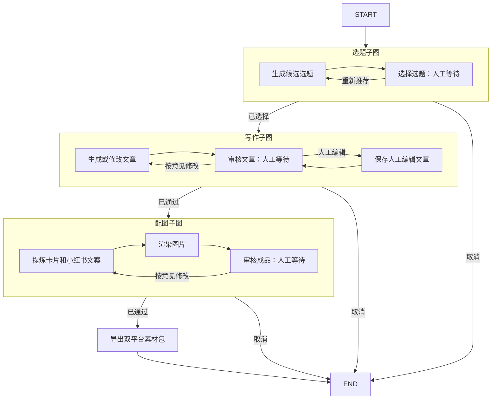

# LangGraph 子图编排

更新日期：2026-11-11  
状态：选题、写作和配图已拆为独立 SubGraph；不兼容旧单图检查点。

## 1. 主图与子图职责



主图只负责组合和导出：`topics → writing → images → export`。各子图内完成生成、人工审核和修改循环，通过审核后结束本子图；取消会返回 `stage=cancelled`，由主图直接结束，不进入后续子图。

- **选题子图**：根据用户输入方向返回 3～5 个选题，支持重新推荐，确认后输出选题列表及选中序号。
- **写作子图**：根据选中题目生成文章，支持 AI 重写、人工编辑，每次修改重新审核。
- **配图子图**：从文章提炼 3～5 张卡片及小红书文案，渲染后审核；支持退回重新制作。
- **主图导出**：成品审核通过后，输出小红书 PNG/文案与公众号 Markdown/HTML 的 ZIP。

## 2. 模块与接口

```text
backend/media_ops/
├── workflow.py          # 主图 build_graph + 当前状态投影 current_snapshot
└── graphs/
    ├── __init__.py      # 公开子图工厂和 ContentState
    ├── common.py        # 共享状态、人工等待、节点日志、活动检查点
    ├── topics.py        # build_topics_graph(llm, *, checkpointer=None)
    ├── writing.py       # build_writing_graph(llm, *, checkpointer=None)
    └── images.py        # build_images_graph(llm, renderer, *, checkpointer=None)
```

所有工厂返回已编译的 LangGraph，可以直接 `invoke`，也可以作为其他图的节点。共享 `ContentState`，不增加状态转换包装器、子图注册中心或动态流程配置。

| 子图 | 最小输入 | 审核通过后主要输出 |
| --- | --- | --- |
| 选题 | `task_id`、`brief` | `topics`、`topic_index` |
| 写作 | `task_id`、`brief`、`topics`、`topic_index` | `article`、`article_revision` |
| 配图 | `task_id`、`brief`、`article`、`article_revision` | `package`、`package_revision`、`assets` |

`brief` 使用现有 `TaskInput` 结构，包含方向、目标读者、参考资料和选题/图片数量。`stage` 表示当前内容阶段，`decision` 表示最近的人工决策。文章变更仍会清空旧成品；旧内容保存在业务历史和检查点中。

## 3. 独立调用与重新组合

独立运行选题子图：

```python
from media_ops.graphs import build_topics_graph
from media_ops.models import TaskInput
from langgraph.checkpoint.memory import InMemorySaver
from langgraph.types import Command

# llm 为现有 LLM 实例；测试可注入替代实现。
graph = build_topics_graph(llm, checkpointer=InMemorySaver())
config = {"configurable": {"thread_id": "standalone-topics"}}
result = graph.invoke({
    "task_id": "standalone-topics",
    "brief": TaskInput(direction="Python AI 应用开发", topic_count=3).model_dump(),
}, config)
gate = result["__interrupt__"][0]
selected = graph.invoke(Command(resume={gate.id: {
    "interrupt_id": gate.id, "action": "select", "topic_index": 0,
}}), config)
# 选题子图到此结束，不会自动写文章或出图。
```

组合“选题＋写作”，不执行配图：

```python
from media_ops.graphs import ContentState, build_topics_graph, build_writing_graph
from langgraph.graph import StateGraph, START, END

builder = StateGraph(ContentState)
builder.add_node("topics", build_topics_graph(llm))
builder.add_node("writing", build_writing_graph(llm))
builder.add_edge(START, "topics")
builder.add_conditional_edges(
    "topics",
    lambda state: END if state["stage"] == "cancelled" else "writing",
    ["writing", END],
)
builder.add_edge("writing", END)
article_only = builder.compile(checkpointer=checkpointer)
```

默认子图工厂不绑定存储，嵌入主图后继承父图的 PostgreSQL checkpointer，各子图通过命名空间隔离检查点；独立运行时显式传入 checkpointer。上例内存存储仅供演示，独立流程需要跨进程恢复时使用 PostgreSQL。

## 4. 人工审核、状态展示与恢复

子图以编译后的图直接加入主图，不在普通函数中重新调用并复制整条工作流。审核节点通过 `interrupt()` 暂停，Worker 始终使用根 `thread_id` 和中断 ID 恢复主图，LangGraph 自动进入对应子图。

```python
config = {"configurable": {"thread_id": task_id, "job_id": job_id}}
root = graph.get_state(config, subgraphs=True)
# 子图还未结束时，root.values 可能只有进入子图前的数据。
visible = current_snapshot(graph, config)
# visible.values 合并最深活动子图内容；主图 next/config 保留用于执行判断。
# root.interrupts 已包含从子图向上传递的中断。
graph.invoke(Command(resume={interrupt_id: decision}), config)
```

`current_snapshot` 供 Worker、业务状态和历史展示使用。它只做状态投影，不修改检查点，也不将投影后的状态作为新的初始输入重跑工作流。当前主图串行执行，沿活动子图读取最深检查点；未来若引入并行分支，需另行明确多分支展示与合并规则。

恢复规则：

- 首次启动传初始输入；后续审核通过根图发送 `Command(resume=...)`。
- 节点异常先由原生 RetryPolicy 自动重试 5 次，依次等待 1、2、4、8、16 秒，最多执行 6 次。子图内部业务节点和主图导出节点统一使用该策略，子图容器不叠加策略。人工中断不重试。
- 自动重试耗尽后保留失败检查点，人工重试使用 `invoke(None, config)` 继续，不重新生成已经完成的上游内容。
- 旧审核命令重投时检查中断 ID，不能推进新的审核点。
- 业务历史使用最深活动子图的检查点 ID，确保同一子图内多次改稿均有独立快照。
- 图片溢出回到配图子图的成品审核，禁止直接通过，要求精简后重新生成。

## 5. 日志、数据切换与验证

配图子图的 `render_package` 节点内部通过异步 Playwright 并行渲染，默认并发 3、可通过 `RENDER_CONCURRENCY` 配置 1～5。一个浏览器共享上下文，每张卡片独立页面；返回值按输入顺序排列。失败时取消并等待剩余任务，关闭页面和浏览器，再沿用原有溢出审核或节点重试机制。主图和子图连线、共享状态与检查点方式不变，无需新增并行图节点或状态合并逻辑。

选题和写作子图内的生成节点使用 stream=true，配图节点保持非流式。模型 delta.content 通过当前节点上下文写入独立草稿字段，前端通过 SSE 逐步展示；不展示思考内容，完整响应结束后才进行最终结构校验并更新图状态。断流/截断沿用节点重试策略，新尝试的节点 ID 会使草稿重新开始；图的输入/输出和人工中断方式不变。

日志保留中文的流程、执行编号、节点及耗时，新增子图名称，例如：

```text
流程=... 执行=11 子图=写作 节点=生成或修改文章 开始执行
流程=... 执行=11 子图=写作 节点=生成或修改文章 执行完成 耗时=12.345秒
流程=... 执行=11 子图=写作 节点=审核文章 等待人工操作 耗时=0.001秒
```

不记录整个子图的跨审核总时长，避免将人工等待混入执行耗时。

同一节点包装器也可接收 `metrics` 记录器；主图与子图工厂通过可选参数传递，不绑定某个持久化实现。应用 Worker 注入 Store，将每次执行写入 `content_node_runs`，前端顶部通过独立指标接口每秒读取；独立子图测试或复用时可不提供记录器。

模型调用通过当前节点 ContextVar 回写模型与实际 Token 用量，响应到达后、正文校验前保存。人工暂停记录为 waiting，不计入已执行节点数；恢复后作为新的调用记录，耗时不包含停顿时间。失败重试分别保留，进程重启时将遗留 running 记录标记为 interrupted。

同一队列任务内的自动重试沿用 job_id，各次尝试独立记录；退避时间不包含在单次节点耗时中，但计入本次队列任务总耗时。重试日志统一中文，框架重复的英文重试堆栈在 Worker 中抑制，最终失败保留完整堆栈。

本次直接采用子图结构，按用户要求清空本项目业务数据及旧检查点，不编写旧版本迁移或兼容分支。表结构及检查点迁移元数据保留，重新创建任务使用新图。原本地图片与日志不属于数据库数据，不在本次清理范围内。

测试覆盖独立子图、不同组合、三个阶段审核与取消、修改历史、新数据库连接恢复、节点失败后重试、中文节点日志和图片渲染。外部模型测试使用替代实现，不消耗真实模型额度。

参考：[LangGraph 子图官方文档](https://docs.langchain.com/oss/python/langgraph/use-subgraphs)。
